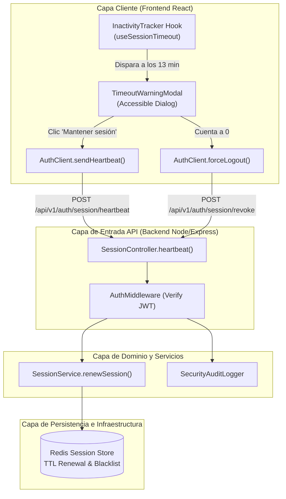
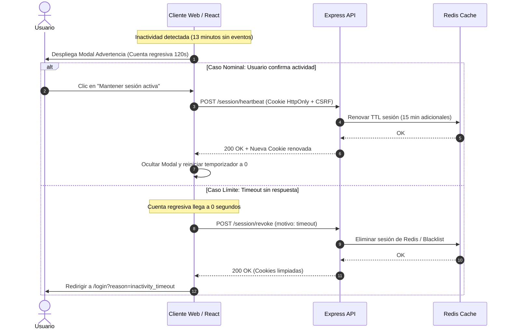

# Documento de Diseño Técnico: US10293 — Advertencia de Expiración de Sesión y Renovación por Heartbeat

> **Identificador Rally:** `US10293`  
> **Basado en:** `.docs/requerimientos.md` (US10293)  
> **Stack Detectado:** `nodejs (TypeScript 5.4, Express / React 18, Redis 7)`  
> **Fecha de Generación:** 2026-10-23  
> **Arquitecto / Agente:** Copilot SDLC Automation Agent  

---

## 1. Diagrama de Arquitectura de Componentes



---

## 2. Inventario de Archivos Impactados

| Ruta de Archivo | Tipo de Acción | Justificación Técnica (Vínculo EARS) |
| :--- | :--- | :--- |
| `src/client/hooks/useSessionTimeout.ts` | **Nuevo** | Hook desacoplado con listeners de inactividad throttled (REQ-EVT-01, REQ-STA-01). |
| `src/client/components/TimeoutWarningModal.tsx` | **Nuevo** | Modal accesible WCAG 2.1 con cuenta regresiva de 120s (REQ-EVT-01, REQ-OPT-01). |
| `src/server/controllers/sessionController.ts` | **Modificar** | Añadir controlador para endpoint de heartbeat y revocación (REQ-EVT-02, REQ-UBI-01). |
| `src/server/services/sessionService.ts` | **Modificar** | Lógica de rotación de tokens y actualización de TTL en Redis (REQ-EVT-02, REQ-UBI-01). |
| `src/server/routes/authRoutes.ts` | **Modificar** | Exposición de las rutas `/session/heartbeat` y `/session/revoke`. |
| `tests/client/useSessionTimeout.spec.ts` | **Nuevo** | Pruebas unitarias frontend con temporizadores falsos de Vitest (REQ-EVT-01, REQ-EVT-03). |
| `tests/server/sessionHeartbeat.spec.ts` | **Nuevo** | Pruebas de integración HTTP supertest para el backend (REQ-EVT-02, REQ-NEG-01). |

---

## 3. Especificación de Nuevos Módulos y Componentes

### 3.1 `src/client/hooks/useSessionTimeout.ts`
- **Responsabilidad:** Gestionar los event listeners de actividad de usuario (`mousemove`, `keydown`, `click`, `scroll`) con throttling de 500 ms. Manejar el estado del temporizador de 13 min y el temporizador de gracia de 2 min.
- **Interfaces Expuestas:**
  ```typescript
  export interface SessionTimeoutState {
    isWarningVisible: boolean;
    remainingSeconds: number;
    isRenewing: boolean;
    extendSession: () => Promise<void>;
    logoutNow: () => Promise<void>;
  }

  export function useSessionTimeout(config?: {
    timeoutMinutes?: number; // Default: 13
    gracePeriodSeconds?: number; // Default: 120
  }): SessionTimeoutState;
  ```

### 3.2 `src/client/components/TimeoutWarningModal.tsx`
- **Responsabilidad:** Renderizar el diálogo modal flotante reteniendo el foco accesible, mostrando el contador regresivo dinámico, el botón de extensión con spinner de carga y el botón de cierre voluntario.

---

## 4. Contratos de Interfaz y Firmas de Endpoints

### 4.1 Endpoint de Renovación por Heartbeat
```http
POST /api/v1/auth/session/heartbeat HTTP/1.1
Host: api.banking.internal
Cookie: sid_access=eyJhbGciOi...; sid_refresh=d8f92a...
X-CSRF-Token: 4a3e21...

HTTP/1.1 200 OK
Content-Type: application/json
Set-Cookie: sid_access=eyJhbGciOi...; HttpOnly; Secure; SameSite=Strict; Max-Age=900; Path=/

{
  "success": true,
  "data": {
    "sessionExpiresAt": "2026-10-23T23:35:00Z",
    "renewedAt": "2026-10-23T23:20:00Z"
  }
}
```

### 4.2 Endpoint de Revocación Inmediata
```http
POST /api/v1/auth/session/revoke HTTP/1.1
Host: api.banking.internal
Content-Type: application/json

{
  "reason": "inactivity_timeout"
}

HTTP/1.1 200 OK
{
  "success": true,
  "message": "Session successfully terminated"
}
```

---

## 5. Registro de Decisiones de Arquitectura (ADR)

| Decisión | Opciones Consideradas | Opción Elegida | Justificación Técnica |
| :--- | :--- | :--- | :--- |
| **Monitoreo de Actividad en UI** | A) Listeners en cada render de React<br>B) Event listeners globales en `window` con `throttle` | **Opción B** | Escucha pasiva centralizada en `document`/`window` con lodash/throttle a 500 ms; consumo de CPU inferior a 0.5%. |
| **Almacenamiento de Tokens** | A) `localStorage`<br>B) Cookies `HttpOnly; Secure; SameSite=Strict` | **Opción B** | Inmune a ataques XSS (OWASP A03). Los scripts del navegador no tienen acceso directo a los tokens en crudo. |
| **Persistencia de Expiración en Backend** | A) Solo validación de fecha en JWT<br>B) Validación híbrida JWT + TTL de clave en Redis | **Opción B** | Permite invalidación instantánea (revocación forzada) sin esperar a que el JWT expire pasivamente. |

---

## 6. Estrategia de Testing

| Nivel de Test | Archivo | Criterio EARS Validado |
| :--- | :--- | :--- |
| **Unitario Frontend** | `tests/client/useSessionTimeout.spec.ts` | `REQ-EVT-01`: Al avanzar el reloj 780s, `isWarningVisible` se vuelve `true`. |
| **Unitario Frontend** | `tests/client/useSessionTimeout.spec.ts` | `REQ-EVT-03`: Al llegar a 0s la ventana de gracia, se dispara redirección a `/login`. |
| **Unitario Frontend** | `tests/client/useSessionTimeout.spec.ts` | `REQ-STA-02`: Mientras se ejecuta `extendSession`, `isRenewing` es `true`. |
| **Integración API** | `tests/server/sessionHeartbeat.spec.ts` | `REQ-EVT-02`: Respuesta 200 con nueva cookie de acceso y TTL renovado en Redis. |
| **Integración API** | `tests/server/sessionHeartbeat.spec.ts` | `REQ-NEG-01`: Retorno 401 si el token enviado está revocado o caducado. |

---

## 7. Consideraciones de Seguridad (OWASP Top 10)

- **A02:2021 — Cryptographic Failures:** Firmas JWT con algoritmo asimétrico RS256 o Ed25519 con claves rotadas.
- **A07:2021 — Identification and Authentication Failures:** Las sesiones inactivas se invalidan activamente en el backend Redis antes de la expiración del token.
- **A09:2021 — Security Logging and Monitoring Failures:** Todo evento de `SESSION_TIMEOUT_EXPIRED` y `SESSION_HEARTBEAT_RENEWED` emite un log JSON estructurado con el identificador de usuario y la IP de origen anonimizada.

---

## 8. Diagrama de Secuencia del Ciclo de Vida de Sesión


