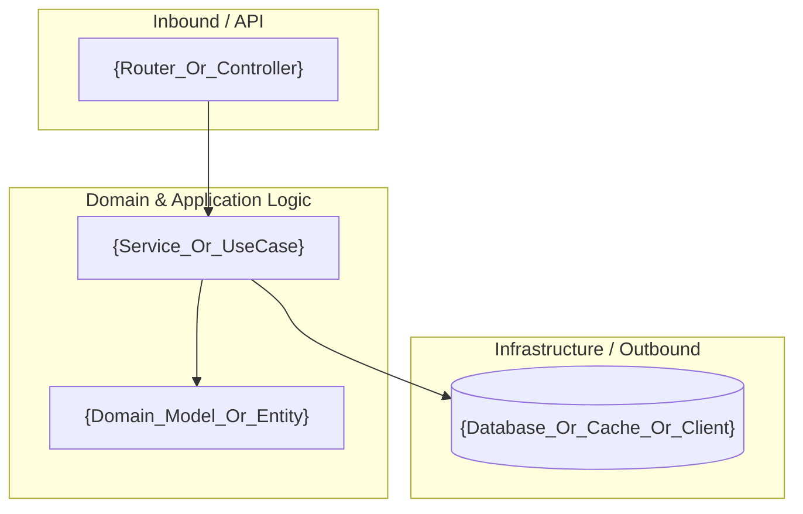
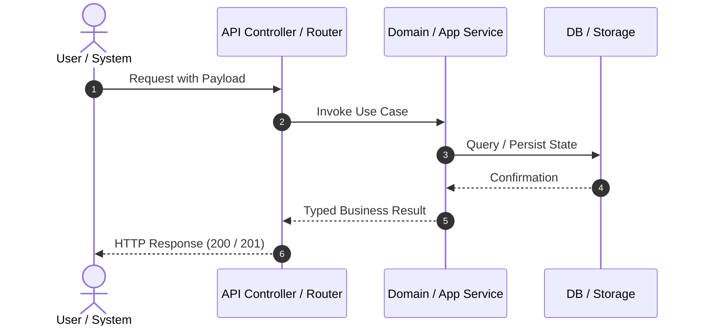

# Technical Design Document: {RALLY_FORMATTED_ID} — {TITLE}

> **Rally FormattedID:** `{RALLY_FORMATTED_ID}`  
> **Source Spec:** `.docs/requirements.md`  
> **Detected Stack:** `{DETECTED_STACK}`  
> **Architectural Pattern:** {Hexagonal (Ports & Adapters) for Java / Modular Layered for Python}  
> **Generation Date:** {DATE}  

---

## 1. Component Architecture Diagram

*(Generate representative Mermaid diagram for the solution)*



---

## 2. Impacted Files Inventory

| File Path | Layer / Module | Action | Technical Rationale (EARS Link) |
| :--- | :--- | :--- | :--- |
| `{path/to/file_1}` | Domain / Service | Create / Modify | `{Linked to REQ-EVT-01}` |
| `{path/to/file_2}` | Repository / Adapter | Create / Modify | `{Linked to REQ-STA-01}` |
| `{path/to/test_file}` | Testing | Create | `{Verifies REQ-EVT-01 and REQ-ERR-01}` |

---

## 3. Data Model & Schemas

```sql
-- SQL Schema Definition (if applicable)
CREATE TABLE IF NOT EXISTS {table_name} (
    id VARCHAR(36) PRIMARY KEY,
    status VARCHAR(20) NOT NULL,
    created_at TIMESTAMP WITH TIME ZONE DEFAULT CURRENT_TIMESTAMP
);
```

---

## 4. Interface Contracts & Method Signatures

### Endpoint / API Signature (if applicable):
```http
POST /api/v1/{resource}
Content-Type: application/json

{
  "field": "value"
}
```

### Function / Service Signatures:
- **Python:** `async def handle_operation(input_data: OperationInput) -> OperationResult:`
- **Java:** `public OperationResult handleOperation(OperationInput input) throws BusinessValidationException;`

---

## 5. Architecture Decision Records (ADR)

| Decision | Options Considered | Decision Taken | Technical Rationale |
| :--- | :--- | :--- | :--- |
| `{Topic}` | `A) ... / B) ...` | `{Option}` | `{Performance, decoupling, scalability rationale}` |

---

## 6. Testing Strategy

| Type | Test File | Target Scenario |
| :--- | :--- | :--- |
| **Unit (Happy Path)** | `tests/...` | `{REQ-EVT-01 nominal execution}` |
| **Unit (Negative / Boundary)** | `tests/...` | `{REQ-ERR-01 error handling}` |
| **Integration** | `tests/...` | `{REQ-STA-01 persistence and end-to-end flow}` |

---

## 7. Main Flow Sequence Diagram


