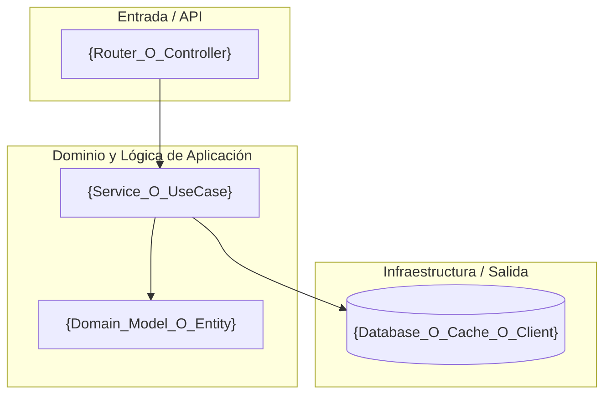
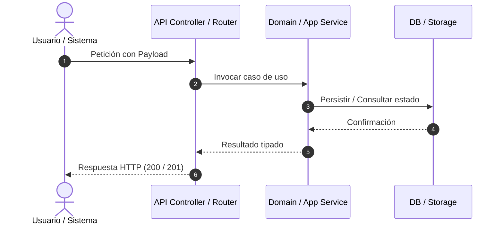

# Documento de Diseño Técnico: {RALLY_FORMATTED_ID} — {TITLE}

> **Identificador Rally:** `{RALLY_FORMATTED_ID}`  
> **Basado en:** `.docs/requerimientos.md`  
> **Stack Detectado:** `{DETECTED_STACK}`  
> **Patrón Arquitectónico:** {Hexagonal (Ports & Adapters) para Java / Modular por Capas para Python}  
> **Fecha de Generación:** {DATE}  

---

## 1. Diagrama de Arquitectura de Componentes

*(Elaborar diagrama Mermaid representativo de la solución)*



---

## 2. Inventario de Archivos Impactados

| Ruta de Archivo | Capa / Módulo | Acción | Justificación Técnica (Vínculo EARS) |
| :--- | :--- | :--- | :--- |
| `{path/to/file_1}` | Dominio / Servicio | Crear / Modificar | `{Vínculo a REQ-EVT-01}` |
| `{path/to/file_2}` | Repositorio / Adapter | Crear / Modificar | `{Vínculo a REQ-STA-01}` |
| `{path/to/test_file}` | Pruebas | Crear | `{Verificación de REQ-EVT-01 y REQ-NEG-01}` |

---

## 3. Modelo de Datos y Esquemas

```sql
-- Definición de esquema SQL (si aplica)
CREATE TABLE IF NOT EXISTS {table_name} (
    id VARCHAR(36) PRIMARY KEY,
    status VARCHAR(20) NOT NULL,
    created_at TIMESTAMP WITH TIME ZONE DEFAULT CURRENT_TIMESTAMP
);
```

---

## 4. Contratos de Interfaz y Firmas de Métodos

### Endpoint / API Signature (si aplica):
```http
POST /api/v1/{recurso}
Content-Type: application/json

{
  "field": "value"
}
```

### Firma de Función / Servicio:
- **Python:** `async def handle_operation(input_data: OperationInput) -> OperationResult:`
- **Java:** `public OperationResult handleOperation(OperationInput input) throws BusinessValidationException;`

---

## 5. Decisiones de Arquitectura (ADR)

| Decisión | Opciones Consideradas | Opción Elegida | Justificación Técnica |
| :--- | :--- | :--- | :--- |
| `{Tema}` | `A) ... / B) ...` | `{Opción}` | `{Motivo técnico y de escalabilidad}` |

---

## 6. Estrategia de Testing

| Tipo | Archivo de Test | Escenario Validado |
| :--- | :--- | :--- |
| **Unitaria (Happy Path)** | `tests/...` | `{REQ-EVT-01 nominal}` |
| **Unitaria (Casos Límite / Error)** | `tests/...` | `{REQ-NEG-01 validación de errores}` |
| **Integración** | `tests/...` | `{REQ-STA-01 persistencia y flujo completo}` |

---

## 7. Diagrama de Secuencia del Flujo Principal


