# 🚀 SDLC Copilot Agent Skill: From Rally Issue to GitLab Merge Request (Python / Java)

> **End-to-End Software Development Life Cycle (SDLC) Automation Solution**  
> Integrates **Broadcom Rally MCP**, **GitHub Copilot Agent Mode**, and **GitLab CLI (`glab`)** under a rigorous **Spec-Driven Development** methodology with mandatory **Human-in-the-Loop** gates, optimized for **Python** and **Java**.

---

## 📌 1. Overview & Workflow

This repository provides an **Agent Skill** and **Custom Agent** for VS Code, designed to transform a business requirement from Broadcom Rally into a verified, documented Merge Request in GitLab:

```
Rally Issue ➔ requirements.md (EARS) ➔ design.md (Mermaid) ➔ Code (Python/Java) ➔ Tests (pytest/mvn) ➔ Git Branch ➔ Draft MR (glab) ➔ Rally Update ➔ report.md
```

### State Machine & Human Gates Diagram

```mermaid
graph TD
    START["🎯 User triggers:<br/>'@sdlc-orchestrator with US10293'"] --> P0["⚙️ Phase 0: Discovery<br/>detect-stack.sh/.bat (Python/Java)"]
    P0 --> P1["📥 Phase 1: Rally Ingestion<br/>Rally MCP: fetch fields"]
    P1 --> V1{"ScheduleState?"}
    V1 -->|Accepted| ABORT["🛑 ABORT<br/>Immutable Artifact"]
    V1 -->|Defined/In-Progress| P1b["📝 Sanitize HTML<br/>Defined ➔ In-Progress"]
    P1b --> G1{"🚪 GATE 1<br/>Confirm Rally Scope?"}
    G1 -->|❌ Adjust| P1
    G1 -->|✅ Approved| P2["📋 Phase 2: Spec Generation<br/>requirements.md + design.md"]
    P2 --> P2a["📄 .docs/requirements.md<br/>(Formal EARS Notation)"]
    P2 --> P2b["📐 .docs/design.md<br/>(Mermaid + Contracts)"]
    P2a --> G2
    P2b --> G2{"🚪 GATE 2<br/>Approve Specifications?"}
    G2 -->|❌ Adjust| P2
    G2 -->|✅ Approved| P3["💻 Phase 3: Implementation<br/>Code + Self-Healing Tests"]
    P3 --> P3a["✍️ Write Python/Java code + Traceability"]
    P3a --> P3b["🧪 Execute test suite (pytest/mvn/gradle)"]
    P3b --> P3c{"Tests passing?"}
    P3c -->|❌ iter < 3| P3a
    P3c -->|❌ iter ≥ 3| FAIL["⚠️ STOP<br/>Request human assistance"]
    P3c -->|✅ 100% Green| G3{"🚪 GATE 3<br/>Approve Implementation?"}
    G3 -->|❌ Adjust| P3
    G3 -->|✅ Approved| P4["🔀 Phase 4: Git + GitLab MR<br/>Branch + Commit + glab CLI"]
    P4 --> P4a["🌿 git checkout -b feature/..."]
    P4a --> P4b["📊 Generate .docs/report.md"]
    P4b --> P4c["📬 glab mr create --draft --yes"]
    P4c --> P4d["💬 glab mr note create"]
    P4d --> G4{"🚪 GATE 4<br/>Validate Draft MR?"}
    G4 -->|❌ Adjust| P4
    G4 -->|✅ Approved| P5["🏁 Phase 5: Rally Closure<br/>Sync & Bidirectional Links"]
    P5 --> P5a["✅ Rally ScheduleState ➔ Completed"]
    P5a --> P5b["💬 Discussion Note in Rally"]
    P5b --> DONE["🎉 SDLC Cycle Completed<br/>Pending: PO Acceptance"]
```



---

## 📂 2. Repository Structure

```text
Issue_to_PR_Gemini/
├── .github/
│   ├── agents/
│   │   └── sdlc-orchestrator.agent.md        ← Senior orchestrator agent (@sdlc-orchestrator)
│   │
│   ├── skills/
│   │   └── sdlc-automation/
│   │       ├── SKILL.md                      ← Standard Operating Procedure (SOP)
│   │       │
│   │       ├── references/                   ← Technical knowledge base
│   │       │   ├── ears-notation.md          ← Syntax guide for 5 core EARS patterns
│   │       │   ├── rally-fields-map.md       ← WSAPI mapping, state machine & HTML sanitization
│   │       │   ├── quality-checklist.md      ← SOLID, OWASP Top 10 & code hygiene checklist
│   │       │   └── glab-commands.md          ← Non-interactive GitLab CLI reference
│   │       │
│   │       ├── templates/                    ← Standardized documentation templates
│   │       │   ├── requirements.md           ← Formal EARS requirements template
│   │       │   ├── design.md                 ← Technical design & Mermaid architecture template
│   │       │   ├── report.md                 ← Post-task quality report template
│   │       │   └── mr-description.md         ← GitLab Merge Request body template
│   │       │
│   │       ├── scripts/                      ← Auxiliary executable automation (.sh & .bat)
│   │       │   ├── detect-stack.sh / .bat    ← Automated Python / Java stack detection
│   │       │   ├── git-workflow.sh / .bat    ← Safe Git + glab CLI orchestration
│   │       │   └── validate-rally-fields.sh / .bat ← Rally schema & state machine validator
│   │       │
│   │       └── examples/
│   │           └── completed-cycle/          ← End-to-end reference examples by stack
│   │               ├── requirements_python.md, design_python.md, report_python.md
│   │               └── requirements_java.md, design_java.md, report_java.md
│   │
│   └── copilot-instructions.md               ← High-level directives and routing
│
├── .vscode/
│   └── mcp.json                              ← Secure Rally MCP server configuration
│
└── README.md                                 ← Global project documentation
```

---

## 🛠️ 3. Prerequisites & Setup

### 1. Development Environment
- **Visual Studio Code** with **GitHub Copilot Agent Mode** support.
- **Runtimes:** Python 3.10+ (`pytest`, `poetry`, `pip`) or Java 17+ (Maven `mvn` or Gradle `gradle`).
- **Git** initialized in the project workspace.
- **GitLab CLI (`glab`)** installed and authenticated:
  ```bash
  glab auth status
  # If unauthenticated:
  glab auth login
  ```

### 2. Rally MCP Configuration
The `.vscode/mcp.json` file defines the MCP server. VS Code will securely prompt for the Personal Access Token (PAT) upon startup without hardcoding secrets:
```json
{
  "servers": {
    "rally-mcp": {
      "type": "http",
      "url": "https://mcp.rallydev.com/mcp",
      "headers": {
        "Authorization": "Bearer ${input:rally_pat}"
      }
    }
  }
}
```

---

## 🚀 4. Step-by-Step Usage

### Step 1: Trigger the Agent
In VS Code Copilot Chat in **Agent Mode**, run:
```text
@sdlc-orchestrator Implement user story US10293
```
*Or alternatively:*
```text
Automate Rally requirement US10293 to Merge Request
```

### Step 2: Human Review Gates
The agent halts deterministically at each of the 4 gates:

1. **Gate 1 (Rally Context):** Reviews sanitized title, description, and criteria. Confirms scope.
2. **Gate 3 (Spec Approval):** Inspects `.docs/requirements.md` and `.docs/design.md`.
3. **Gate 3 (Implementation Review):** Verifies changed file summary and 100% green test suite.
4. **Gate 4 (MR Verification):** Inspects Draft MR link in GitLab before closing Rally issue.
